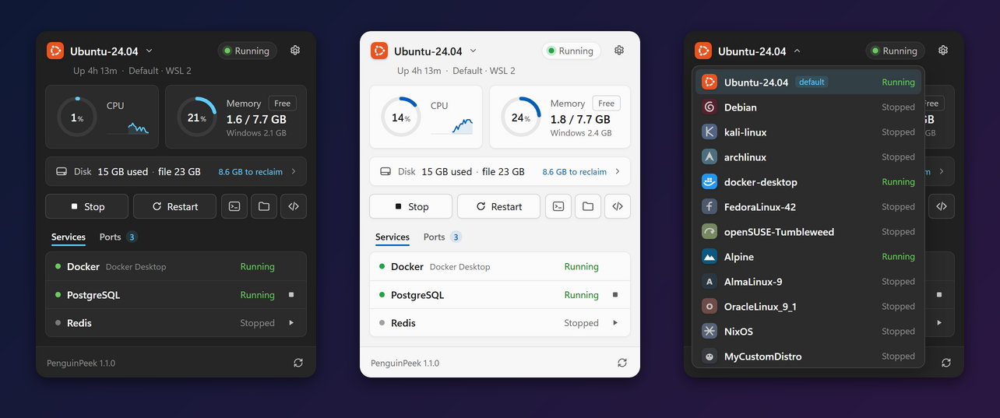
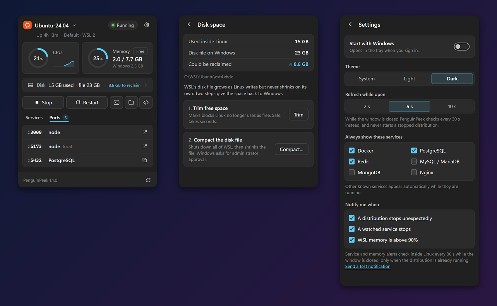

<p align="center">
  
</p>

<h1 align="center">PenguinPeek</h1>

<p align="center">
  A tiny Windows tray app for keeping an eye on WSL2 — and doing the everyday things with one click.
</p>

<p align="center">
  <a href="../../releases/latest">Download</a> ·
  <a href="#features">Features</a> ·
  <a href="#performance">Performance</a> ·
  <a href="#building-from-source">Build</a> ·
  <a href="CHANGELOG.md">Changelog</a>
</p>

<p align="center">
  
</p>

PenguinPeek lives in the notification area. Click the penguin and a small
Windows 11-style flyout shows how your WSL2 distro is doing: CPU, memory,
disk, the dev services you care about, and the ports your servers are
listening on. Start, stop or restart the distro, open a terminal, its home
folder or VS Code, and get a notification when something stops unexpectedly.

It is built to stay out of the way: **no CPU to speak of while it sits in the
tray, ~21 MB of RAM, and it never starts a stopped distro on its own.**

## Features

**Status at a glance**
- Tray icon that shows whether the selected distro is running, stopped or busy;
  hover for CPU and RAM.
- CPU usage with a one-minute sparkline, memory and swap inside Linux, uptime.
- What WSL really costs your PC (the `vmmemWSL` process), with a **Free**
  button that releases Linux's file cache so Windows gets the RAM back.
- Disk space used inside Linux vs. the size of the virtual disk on Windows,
  with a guided **trim + compact** to reclaim it.

**Everyday controls**
- Start / Stop / Restart, and *Shut down WSL* from the tray menu.
- One-click **Terminal** (Windows Terminal when installed), **home folder in
  File Explorer** and **VS Code** connected through Remote - WSL.
- Pick between your distros, each with its icon and state. The list is
  remembered between runs; a newly installed distro shows up as soon as it
  runs, or use *Refresh list* in the picker.

**Development services**
- Status for Docker, PostgreSQL, Redis, MySQL/MariaDB, MongoDB and Nginx —
  start or stop them with a click (systemd or `service`, run as root).
- Docker Desktop is recognised too, and so is the GitHub Copilot CLI
  (`copilot` sessions and its `copilotd` daemon), shown but not controlled.
- **Containers** tab: every Docker container with its image and status,
  grouped by Compose project. Start, stop or restart one container or a
  whole project. Works with Docker inside the distro and with Docker
  Desktop's WSL integration; the list is only read while the tab is open.
- **Ports** tab: everything listening inside Linux; click to open
  `http://localhost:<port>`, or copy the address for databases.

**Alerts**
- Windows notifications when a distro stops without being asked, a watched
  service stops, or WSL memory goes above 90%. Each one can be turned off.

**Fits in**
- Light and dark themes (or follow Windows) in a plain, solid Windows 11 style.
- Optional start with Windows.

<p align="center">
  
</p>

## Requirements

- Windows 11, or Windows 10 21H2 or later (x64 or ARM64)
- WSL2 with at least one distribution (`wsl --install`)
- Microsoft Edge WebView2 Runtime — preinstalled on Windows 11 and on up-to-date
  Windows 10

WSL1 distributions are not shown; PenguinPeek monitors the WSL2 VM.

## Install

1. Download `PenguinPeek-<version>-windows-x64.exe` (or `-arm64.exe`) from the
   [latest release](../../releases/latest).
2. Put it somewhere permanent, e.g. `%LOCALAPPDATA%\Programs\PenguinPeek\`, and
   run it. The penguin appears in the tray (it may be in the `^` overflow
   menu; drag it onto the taskbar to keep it visible).
3. Optional: open ⚙ Settings → **Start with Windows**.

> The executable isn't code-signed yet, so Windows SmartScreen may warn on
> first launch. Choose **More info → Run anyway**, or build it yourself.

**Uninstall:** turn off *Start with Windows*, quit from the tray menu, then
delete the exe plus `%APPDATA%\PenguinPeek` (settings) and
`%LOCALAPPDATA%\PenguinPeek` (WebView2 cache).

## Using it

| Action | How |
| --- | --- |
| Open / close the flyout | Left-click the tray icon (closes on click-away or `Esc`) |
| Quick actions, Shut down WSL, Quit | Right-click the tray icon |
| Switch distro | Click the distro name at the top of the flyout |
| Start / stop a service | ▶ / ■ next to it on the **Services** tab |
| Open a server | **Ports** tab → ↗ |
| Reclaim disk space | Click the **Disk** row → *Trim*, then *Compact…* |
| Pick up a newly installed or removed distro | Distro picker → *Refresh list* |
| Choose services, alerts, theme, refresh rate | ⚙ Settings |

## Performance

Measured with [`scripts/bench.ps1`](scripts/bench.ps1) (`wails3 task bench`)
on a Windows 11 PC with one running Ubuntu distro and default settings. CPU is
the average share of one logical core; RAM is summed over PenguinPeek and its
WebView2 helper processes.

| State | Processes | CPU | RAM (working set) | RAM (private) |
| --- | --- | --- | --- | --- |
| In the tray, flyout never opened | 1 | **< 0.1 %** | **21 MB** | 50 MB |
| Flyout open, live metrics every 5 s (default) | 7 | 0.8 % | 340 MB | 148 MB |
| Flyout open, live metrics every 2 s | 7 | 1.1 % | 339 MB | 145 MB |
| 60 s after closing the flyout | 1 | **0 %** | **36 MB** | 56 MB |

Most of the "open" RAM is the WebView2 runtime itself; it is all returned
when the flyout's WebView is released. The CPU figures leave out the
short-lived `wsl.exe` calls: with the flyout open that is two per refresh
(about 0.2 s of mostly waiting each), and one every 30 s while it is closed.

| On disk | Size |
| --- | --- |
| `PenguinPeek.exe` | 11 MB |
| WebView2 cache (`%LOCALAPPDATA%\PenguinPeek`) | ~5 MB |
| Settings | < 1 KB |

How it stays this small:

- **One loop, in Go.** A single goroutine owns all monitoring and *pushes*
  updates; the UI never polls.
- **Adaptive cadence.** While the flyout is open: `wsl.exe --list --running`
  plus one guest sample per refresh. The guest script uses shell built-ins
  only (no `cat`, `grep` or `sort` processes) and reads disk usage, `$HOME`
  and the distro type just every 30 s. While hidden: one
  `wsl.exe --list --running` every 30 s for the tray icon, plus a lighter
  guest sample only if service/memory alerts are on and the distro is
  already running.
- **Installed distros are cached.** The full `wsl --list --verbose` runs once
  and is saved with the settings, instead of on every refresh.
- **No WebView while idle.** The flyout's WebView2 is created on the first
  click and destroyed 60 s after it closes, so its ~6 helper processes exit.
- **Never wakes WSL.** Nothing runs inside a stopped distro unless you click
  something that obviously starts it (Start, Terminal, Files, VS Code).
- **Lean WebView.** Software rendering, a single renderer process and no Edge
  component downloads.
- **Nothing to repaint.** Solid surfaces, no transparency, gradients or
  animations (only a spinner while an action runs), so between updates the
  WebView is idle.

## Privacy and permissions

- PenguinPeek makes **no network requests** and has **no telemetry**.
- It runs `wsl.exe` (list, metrics script, terminate/shutdown) and, only when
  you click the matching button, fixed commands **as root** inside the distro:
  service start/stop, dropping the page cache, `fstrim`.
- *Compact disk* asks for administrator approval (UAC), runs `wsl --shutdown`
  and compacts the distro's VHDX with `diskpart` in a visible window.
- *Start with Windows* adds a per-user entry under
  `HKCU\Software\Microsoft\Windows\CurrentVersion\Run`.
- Settings, including the cached list of installed distros:
  `%APPDATA%\PenguinPeek\settings.json`.

## Building from source

Prerequisites: Go 1.27+, Node.js 22+, [pnpm](https://pnpm.io), and the Wails v3 CLI.

```bash
go install github.com/wailsapp/wails/v3/cmd/wails3@v3.1.0
cd frontend && pnpm install && cd ..
wails3 build                 # -> bin/PenguinPeek.exe
wails3 task install          # optional: install for your user + desktop shortcut
```

The app is Windows-only but cross-compiles from WSL (no cgo); when installing
the CLI inside WSL use `CGO_ENABLED=0 go install ...`. For ARM64:
`wails3 task build ARCH=arm64`.

See [CONTRIBUTING.md](CONTRIBUTING.md) for tests, the mock UI, benchmarks and
release steps.

### Project layout

```
main.go, window.go       app, tray, flyout lifecycle (lazy WebView)
service.go               methods the frontend can call
notify.go                Windows notifications
internal/wsl/            wsl.exe runner, guest script, /proc parsers
internal/monitor/        the polling loop, snapshots, service catalog
internal/host/           Windows side: VM memory, VHDX, autostart, compaction
internal/alerts/         turns snapshots into alerts
internal/settings/       JSON settings
frontend/                Svelte 5 + TypeScript (runes), Vite
scripts/                 install, benchmark and version tooling
```

## Built with

[Go](https://go.dev) · [Wails v3](https://v3.wails.io) ·
[Svelte 5](https://svelte.dev) · [Vite](https://vite.dev) ·
[go-toast](https://git.sr.ht/~jackmordaunt/go-toast) (via Wails notifications)

## License

[MIT](LICENSE) © PenguinPeek contributors.

Linux distribution names belong to their respective owners. The distro badges
in PenguinPeek are simplified illustrations, not official logos, and imply no
endorsement.
